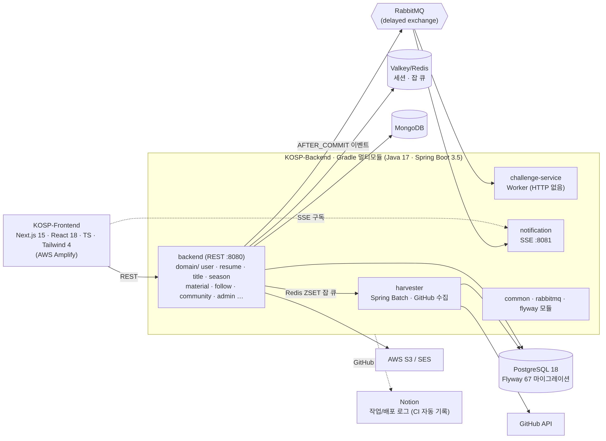
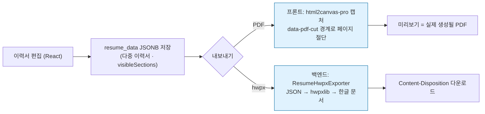

# K-OSP Backend — 한국기술교육대학교 오픈소스 포털

> 학생이 GitHub에서 한 활동이 학교 안에서 보이지 않는다. 이력서에 쓸 때마다 저장소를 다시 뒤진다.
> K-OSP는 GitHub 활동을 자동 수집해 **랭킹 · 칭호 · 이력서**로 바꿔 주는 교내 서비스다. 실사용자가 있는 운영 중인 서비스다.

| 항목 | 내용 |
|---|---|
| 운영 주체 | 한국기술교육대학교 SW중심사업단 (팀 Dot) |
| 팀 | 개발 2명(윤우성 · 강준형, 풀스택) + 디자인 1명(김민지). 2026년 이전 기여자: 박성빈 · 박태진 외 |
| **내 역할 (윤우성, 2026.02 ~)** | 팀장 · 백엔드/프론트 — 칭호(Title) 시스템 · 시즌 랭킹/티어 · 다중 이력서 API · 이력서 PDF/hwpx 출력 · 학습자료(과제/EL) 도메인 · 팔로우 · GitHub 저장소 → 이력서 가져오기 · Notion 자동 기록 CI · 약관 동의 정책 |
| 스택 | Java 17 · Spring Boot 3.5.7 · Gradle 멀티모듈(Kotlin DSL) · JPA · **PostgreSQL 18 + Flyway(34)** · Valkey(Redis) · MongoDB · RabbitMQ · Spring Batch · AWS S3/SES · JaCoCo |
| 본인 커밋 | 백엔드 33건 · 프론트 58건 (2026.04 ~ 09) · Flyway 마이그레이션 35건 추가 |

프론트엔드: [KOREATECH-OSP/KOSP-Frontend](https://github.com/KOREATECH-OSP/KOSP-Frontend) (Next.js 15 · React 18 · TypeScript · Tailwind 4)

---

## 1. 아키텍처



Gradle 멀티모듈 + RabbitMQ 이벤트 버스. REST API(`backend`)는 DB 커밋 이후(`AFTER_COMMIT`)에만 이벤트를 발행하고, 무거운 일(GitHub 수집 · 챌린지 평가 · 알림)은 별도 모듈이 큐에서 받아 처리한다. 수신 측은 수동 ACK와 `processed_messages` 테이블로 중복 처리를 막는다.

```
backend/            REST API :8080  — domain/{user,resume,title,season,material,follow,community,admin,…}
harvester/          Spring Batch — GitHub 활동 수집 (Redis ZSET 잡 큐로 트리거)
challenge-service/  Worker — 챌린지 평가 (HTTP 없음)
common/ rabbitmq/ flyway/   공유 엔티티 · 이벤트 DTO · 마이그레이션 34개
infra/              docker-compose (PostgreSQL · Valkey · MongoDB · RabbitMQ) · nginx · deploy.sh
.github/workflows/  ci.yml · worklog.yml · worklog-daily.yml (커밋 → Notion 작업 로그 자동 기록)
```

코드 규칙(`AGENTS.md`): 들여쓰기 깊이 1 · `else` 금지 · 메서드 10줄 · 엔티티 `@Setter` 금지 · 소프트 삭제 · 예외는 `GlobalException(ExceptionMessage)`만.

## 2. 내가 맡은 도메인과 기술 결정

| 결정 | 선택지 | 고른 것 | 버린 이유 | 근거 |
|---|---|---|---|---|
| **이력서 한글(hwpx) 출력** | ① 프론트에서 HTML→문서 변환 ② 백엔드에서 `hwpxlib`로 직접 생성 ③ PDF만 제공 | **②** | 사업단·학생 모두 한글 파일 제출이 필요했다. ①은 브라우저가 hwpx를 렌더링할 수 없어 미리보기 불가. 백엔드에서 `resume_data`(JSONB)를 읽어 문서를 만들고, **미리보기는 PDF로 통일**해 "보이는 그대로 받는다"를 지켰다 | `domain/resume/export/ResumeHwpxExporter.java`, 커밋 `feat(resume): 이력서 hwpx 내려받기 API`(9/19) |
| **시즌 티어** | ① 절대 점수 구간 ② 백분위 ③ 백분위 + 상위 티어만 절대 조건 | **③ 7단계** | 시즌마다 참여 인원이 달라 절대 점수는 시즌 간 비교가 안 되고, 순수 백분위는 활동이 적은 시즌에 상위 티어가 헐값이 된다. 백분위로 나누되 마스터/챌린저는 절대 점수 조건을 추가 | `domain/season`, 커밋 `feat(season): 티어 백분위 기반 7단계`(7/21) |
| **학교 LMS(아우누리) 과제 연동** | ① 서버가 학교 계정으로 크롤링 ② 브라우저 확장으로 사용자 측에서 수집 → 서버는 결과만 | **②** | 학교 계정 비밀번호를 서버에 저장하지 않기 위해. 완전 자동화는 학교 공식 API/OAuth 협조가 필요해 교수님께 요청 중 | `domain/material`, 커밋 `feat: 아우누리 과제/EL 자료 수집·이력서 자동연결`(7/20) |
| **약관 재동의 정책** | ① 미동의 즉시 차단 ② 유예 → 비활성화 → 보관 → 삭제 | **② 7일 유예 · 30일 보관** | 계정 삭제는 되돌릴 수 없어 단계를 둠. 관리자 권한 보유자는 면제하되 권한 상실 시 대상. 약관 본문 검토는 학교 개인정보 부서 소관으로 분리 | `domain/terms` |
| **개발 기록** | ① 수기 보고서만 ② 커밋 → Notion 자동 집계 | **② + 주간 리포트** | 월간 보고서만으로는 "무엇을 왜 했는지" 복원이 안 됐다. CI가 변경 파일·API·마이그레이션 수를 집계해 Notion에 쌓고, 판단·회고는 주간 리포트에 손으로 쓴다 | `.github/workflows/worklog*.yml`, 커밋 `2ad55f18`(7/13) |

### 이력서 출력 흐름



## 3. 트러블슈팅

### 3-1. Flyway V29 중복 → 백엔드 기동 실패, nginx 502 (8/3, `d0ce68b4`)

**증상** 배포 직후 백엔드가 부팅에 실패하고 nginx가 502. 로그: `Found more than one migration with version 29`.

**원인** 커피챗의 `V29__create_coffee_chat_rooms.sql`(이미 dev 적용)과 내가 추가한 `V29__invite_restriction.sql`이 같은 번호. 두 기능이 다른 브랜치에서 각자 "다음 번호"를 잡았다.

**왜 CI가 못 잡았나** 테스트 프로필이 Flyway를 끄고 H2 `create-drop`으로 스키마를 만든다(`application-test.yml`). 마이그레이션 충돌은 실제 DB에서만 드러났다.

**조치** 이미 적용된 V29는 그대로 두고 내 파일을 다음 빈 번호 V33으로 변경. 데이터 손실 없음.

**재발 방지로 배운 것** 번호 충돌은 머지 전에 잡혀야 한다. 다시 한다면 CI에 "마이그레이션 버전 중복 검사" 한 줄을 넣거나, 테스트 프로필에서도 Flyway를 켜서 H2에 적용해 본다.

### 3-2. 초대 상세 조회 500 — `LazyInitializationException` (6/24, `6696e841`)

**증상** `getInvite` 호출 시 `Could not initialize proxy - no session`.
**원인** 트랜잭션 밖에서 LAZY 연관(team · inviter · invitee)에 접근.
**조치** `TeamService`와 동일하게 서비스 클래스 레벨 `@Transactional(readOnly = true)`. 2줄 변경.
**남은 것** 같은 패턴이 다른 서비스에도 있는지 점검하는 습관. 증상은 500 하나지만 원인은 영속성 컨텍스트 범위라는 것을 로그 한 줄로 바로 연결할 수 있게 됐다.

### 3-3. 이력서 PDF가 글자 중간에서 잘림 (프론트, 9/19, `fbe3502`)

**원인** 페이지 절단 후보를 `<section>` 경계에서만 찾았는데, 프로젝트 10건이 섹션 하나라 자를 곳이 섹션 끝 한 군데뿐. A4를 넘으면 강제 절단.
**조치** 절단 후보를 `data-pdf-cut` 속성이 붙은 **항목 경계까지 세분화**(9곳). 클래스명·DOM 구조로 찾으면 스타일 변경 시 조용히 깨지므로 전용 data 속성을 썼다. 페이지 맨 위에 붙는 몇 px짜리 페이지를 막는 `MIN_PAGE_FILL_RATIO=0.15` 추가.
**결과** 시뮬레이션 기준 강제 절단 5회 → 0회. 페이지 수 10 → 12 (글자를 자르지 않는 대가).
**연관** 그 전엔 Tailwind 4의 `oklch()` 색상을 `html2canvas`가 파싱하지 못해 PDF 생성 자체가 실패 → `html2canvas-pro`로 교체(6/23, `a9047fc`).

### 3-4. 운영 중 일어난 일

| 시점 | 일 | 조치 |
|---|---|---|
| 7/13 | 개발 서버 용량 초과로 다운 | 복구 최우선, 이후 트래픽 테스트 일정을 8월로 앞당김 |
| 10/26 | 정보화운영팀 긴급 요청 — Node.js · Oracle Java 취약점(CVE-2026-91403, CVE-2026-111497) | 익일 기한 내 Java(Corretto 17) 패치, 프론트 Node 20(EOL) → 22 |
| 9월~ | 커밋되지 않은 변경이 배포에서 빠져 기능이 동작 안 하는 일 반복 | "깨끗한 worktree에서 검증" 규칙 |

## 4. 숫자

| 구분 | 값 | 출처 |
|---|---|---|
| 모듈 | 6 (backend · harvester · challenge-service · common · rabbitmq · flyway) | `settings.gradle.kts` |
| 도메인 | 22 (`backend/.../domain/*`) | 패키지 수 |
| 마이그레이션 | Flyway 34개 (본인 추가 이력 35건, 번호 변경 포함) | `flyway/src/main/resources/db/migration` |
| 테스트 | 60 클래스, JaCoCo 리포트 | `src/test`, `backend/build.gradle.kts` |
| 본인 기여 (2026.04~09) | BE 33커밋 / FE 58커밋, BE +20,045줄 (develop 기준) | `git log origin/develop --author=yoonwoosung --shortstat` |
| 자동 기록 | Notion 작업/배포 로그 54건 (CI) | `.github/workflows/worklog*.yml` |
| 운영 | 실사용자 있음(교내), 사업단 월간 개발보고서 · 9월부터 주간 리포트 | — |

측정하지 못한 것: 응답시간 · 동시 접속. 8월 가상 트래픽 테스트를 계획했으나 실행하지 못했다.

## 5. 한계와 다시 한다면

- **마이그레이션 번호 충돌을 CI가 못 잡는다.** 테스트가 Flyway를 끄기 때문. 위 3-1.
- **다중 인스턴스에서 스케줄러에 분산 락이 없다.** 시즌 마감 배치가 두 번 돌 수 있는 구조를 확인했지만(P0 리스크로 정리), 이력서 기능을 우선해 보류했다. 다시 한다면 ShedLock부터 건다.
- **기록 자동화가 기록을 대신하지 못했다.** Notion 자동 로그 54건 중 회고·수치를 직접 적은 건 1건(7/15). 8월 공백 뒤 9월부터 주간 리포트로 바꿨다 — 도구가 아니라 주기가 문제였다.
- **AI 코딩 도구 사용.** 커밋 트레일러에 남아 있듯 상당량을 Claude로 작성했다. 그래서 커밋 본문에 원인·대안·검증을 적는 것을 규칙으로 뒀다(3-1 · 3-3의 커밋 메시지가 그 예).

## 6. 관련 문서

- [AGENTS.md](AGENTS.md) — 모듈 구조 · 코딩 규칙 · 이벤트 흐름 (개발자/에이전트 공용)
- [docs/convention.md](docs/convention.md) · [docs/기능명세서.md](docs/기능명세서.md) · [docs/github-crawling.md](docs/github-crawling.md)
- [HELP.md](HELP.md) — 빌드 · 실행

```bash
./gradlew build            # 전체 빌드 + 테스트 (JaCoCo 리포트 생성)
./gradlew bootRun          # backend 실행 (.env.local 필요)
./gradlew :harvester:bootRun
```
